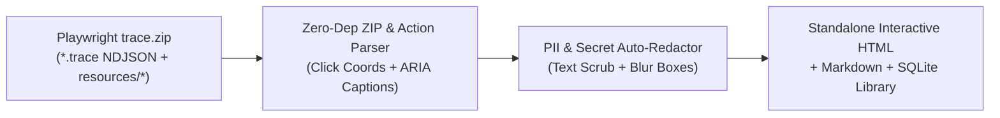

# traceguide

**Self-hosted ScribeHow and Arcade alternative. Turn Playwright `trace.zip` files into auto-redacted interactive step-by-step click-through guides and Markdown docs that auto-refresh in CI (CLI, SQLite library server, Docker, and GitHub Action with zero runtime dependencies).**

[](./LICENSE)
[](https://nodejs.org)
[](#architecture)

---

## Try It in 2 Seconds (Zero Setup)

```bash
npx traceguide --demo
```

Generates a real Playwright-format `trace.zip` for a 4-step "Create Production API Key" flow, auto-redacts email and secret inputs with blur masks, and outputs a standalone zero-dependency interactive click-through player at `./traceguide-demo.html`.

---

## Quick Start

```bash
# Compile any Playwright trace.zip into an interactive HTML guide + Markdown doc
npx traceguide build test-results/checkout/trace.zip \
  --redact-pii \
  --title "Checkout Walkthrough" \
  --out ./docs/checkout-guide.html \
  --markdown ./docs/checkout-guide.md

# Run the self-hosted SQLite guide library server (127.0.0.1:4320)
npx traceguide serve
```

### Reusable GitHub Action (Auto-Update Docs on Every PR)

```yaml
- uses: flipcyde101/traceguide@v0.1.0
  with:
    trace: test-results/onboarding/trace.zip
    out: ./docs/onboarding.html
    markdown-out: ./docs/onboarding.md
    redact-pii: "true"
```

### 10-Line Self-Hosted Docker Sidecar (`docker-compose.yml`)

```yaml
services:
  traceguide:
    build: .
    ports:
      - "4320:4320"
    volumes:
      - traceguide_data:/data
volumes:
  traceguide_data:
```

---

## How `traceguide` Works

- **Pure-TS zero-dependency ZIP parser:** Reads Playwright `trace.zip` archives directly with `node:zlib`, enforcing strict zip-slip path rejection and decompression size caps.
- **ARIA/role auto-captions + click rings:** Matches Playwright actions (`goto`, `click`, `fill`, `press`, `check`, `selectOption`) to their nearest `screencast-frame` image and draws animated click rings at exact `(x, y)` coordinates.
- **Automatic PII & secret redaction (`--redact-pii`):** Scrubs emails, passwords, Bearer/JWT tokens, OpenAI/GitHub/AWS API keys, and card numbers from captions and overlays blur masks directly over sensitive regions.
- **Standalone HTML + Markdown + `<iframe>` embed:** Outputs a zero-dependency single HTML file with keyboard navigation (`ArrowLeft`/`ArrowRight`), 1-click **Copy Markdown**, and 1-click **Copy Embed `<iframe>`**.

---

## Honest Comparison

| Feature | `traceguide` | ScribeHow / Tango / Arcade | Playwright Trace Viewer |
|---|---|---|---|
| **Self-hosted / MIT open source** | **Yes** (single Node 24 package / Docker) | No (per-seat SaaS) | Local debug viewer |
| **Auto-updates guides from CI E2E traces** | **Yes** (`trace.zip` + GitHub Action) | Manual re-recording | No customer guide output |
| **Built-in PII & secret auto-redaction** | **Yes** (`--redact-pii` + blur masks) | Paid tiers / manual | No |
| **Where commercial tools win** | (CI-driven docs & zero SaaS cost) | Browser click-recorder extensions, voiceover/AI narration, hosted team analytics | Deep DOM/network/console test failure debugging |

---

## Architecture



## License

[MIT](./LICENSE)
